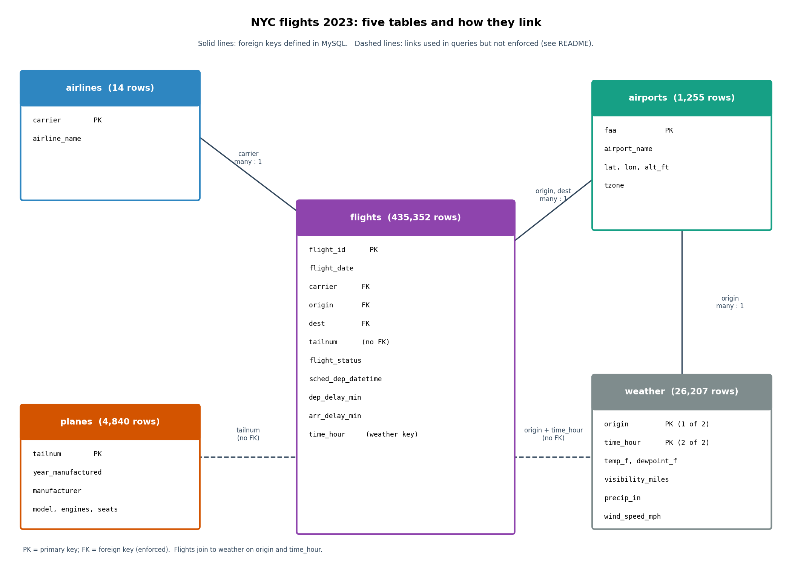
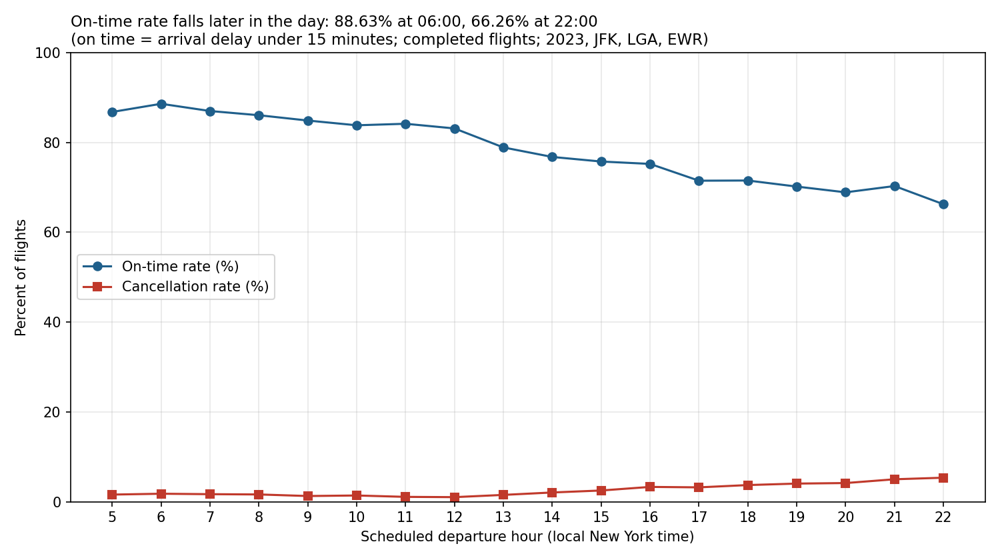
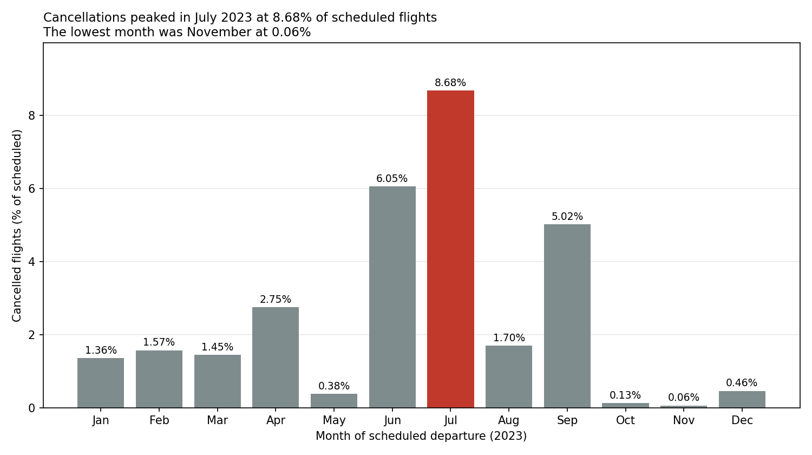
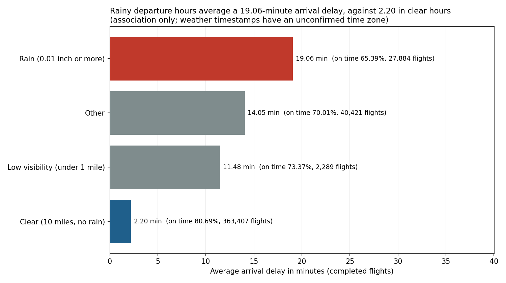

# NYC Flights 2023: MySQL database design and business queries

## What this project shows

This project designs a small MySQL 8.0 database for 435,352 flights that departed New York's
JFK, LGA and EWR airports in 2023, loads it with a Python script, checks the data, and answers
twelve business questions with SQL. It covers table design (keys, foreign keys, indexes), data
checks, joins, conditional aggregation, window functions, date and time functions, a weather join,
an anti-join, an EXISTS subquery, two reusable views, and a repeatable rebuild from scratch.

**The short answer:** flights are less likely to be on time as the day goes on, cancellations cluster
in June, July and September, and rain is associated with much longer arrival delays. Section
"Findings" lists the numbers.

## Entity-relationship diagram



Five tables: `flights` (one row per scheduled departure) links to `airlines` and `airports` with
foreign keys. `weather` (one row per airport per hour) links to `airports`. Two links are used in
queries but are not enforced as foreign keys, because the data does not fully match them (see
Limitations): `flights.tailnum` to `planes.tailnum`, and `flights (origin, time_hour)` to
`weather (origin, time_hour)`.

## Files

```
nyc-flights-sql-analysis/
  README.md                     this file
  requirements.txt              Python packages (minimum versions)
  load_data.py                  loads the cleaned CSV and zip files into MySQL
  export_results.py             runs the 12 queries and saves each result as a CSV
  charts.py                     draws the three charts and the ER diagram
  .gitignore
  sql/
    01_schema.sql               creates the database and the five tables
    02_load_data.sql            optional pure-SQL loader (needs the zip unpacked first)
    03_data_checks.sql          row counts, keys, orphans, nulls, status rules
    04_analysis_queries.sql     the twelve business questions
    05_views.sql                two reusable views
  data/                         cleaned input tables (see data/README.md)
  results/                      one CSV per query, plus the output of 03_data_checks.sql
  images/                       three charts and the ER diagram (150 dpi)
```

## Setup on Windows

1. **Install MySQL Community Server 8.x** from the MySQL website. Keep the default port (3306) and
   note the root password you set.
2. **Connect with DBeaver**, the SQL client used here. Create a MySQL connection to `localhost`,
   port `3306`, user `root`.
3. **Create the database and tables.** Open `sql/01_schema.sql` in DBeaver and run the whole script
   (Alt+X). It drops and recreates the `nyc_flights` database, so it is safe to re-run.
4. **Install the Python packages** from the project folder:
   `pip install -r requirements.txt`
5. **Set the password** for the current PowerShell window (it is not stored in any file):
   `$env:MYSQL_PASSWORD = "your-root-password"`
   If the variable is not set, `load_data.py` asks for the password once.
6. **Load the data:** `python load_data.py`. It reads `data/flights_clean.zip` directly, so there is
   no need to unzip it. Expected output: flights 435,352, weather 26,207, planes 4,840,
   airports 1,255, airlines 14. The connection defaults are host `localhost` and port `3306`; set
   `MYSQL_HOST`, `MYSQL_PORT` or `MYSQL_USER` in the same way if yours differ.
7. **Check the data:** run `sql/03_data_checks.sql` in DBeaver. Every row count should match, every
   duplicate-key count should be 0, and the orphan counts should match the expected values written
   in the script (9,371 flights with a tail number not in `planes`; 826 flights with no weather row).
8. **Run the queries:** open `sql/04_analysis_queries.sql` in DBeaver to run any question on its own,
   or run `python export_results.py` to save all twelve results to `results/`.
9. **Create the views:** run `sql/05_views.sql` in DBeaver.
10. **Draw the charts:** `python charts.py` saves the three charts and the ER diagram to `images/`.

The queries use only standard MySQL 8.0 syntax. On the test server used to build this project every
query finished in under 10 seconds; the slowest, q01 (airline performance), took about 2.6 seconds
in the final rebuild run, so no extra index was needed.

## The twelve business questions

Definitions used throughout: **on time** means an arrival delay under 15 minutes. Delay metrics use
**completed flights only**. Cancellation rate is cancelled flights divided by all scheduled flights.
Group-level rates (airline, airport, route, weekday, hour, weather group, aircraft age band) are shown
only for groups with at least 1,000 flights. Exceptions, each explained in its query comment: q04 and
q05 are time series (every month and day is kept), q10 lists all airlines as a data-quality check,
q11 lists routes with at least 100 flights, and q12 lists the top 10 days.

| # | File (in `results/`) | Business question | SQL technique shown |
|---|---|---|---|
| q01 | `q01_airline_performance.csv` | Which airlines are most often on time, and which cancel the most? | INNER JOIN to airlines, CASE conditional aggregation, GROUP BY with HAVING |
| q02 | `q02_origin_airport_performance.csv` | How do JFK, LGA and EWR compare on on-time and cancellation rates? | INNER JOIN to airports, CASE conditional aggregation, GROUP BY with HAVING |
| q03 | `q03_top_destinations_by_origin.csv` | What are the three busiest routes from each New York airport? | Two-step CTE chain, DENSE_RANK() window function, join to airports |
| q04 | `q04_monthly_trend_month_over_month.csv` | How do on-time and cancellation rates change from month to month? | DATE_FORMAT date function, CTE chain, LAG() window function |
| q05 | `q05_daily_running_total_and_7day_average.csv` | What is the daily cancellation count, the year-to-date total and the 7-day moving average? | Running total with SUM() OVER, 7-day moving window (ROWS BETWEEN 6 PRECEDING) |
| q06 | `q06_weekday_pattern.csv` | Which days of the week have the most cancellations and delays? | WEEKDAY() and DAYNAME() date functions, GROUP BY with HAVING |
| q07 | `q07_hour_of_day_delays.csv` | How do delays and cancellations change through the day? | HOUR() time function, CASE conditional aggregation, GROUP BY with HAVING |
| q08 | `q08_weather_conditions_and_delays.csv` | Do flights departing in low-visibility or rainy hours run later than in clear hours? | Join to hourly weather on origin and hour (composite key), CASE grouping, two-step CTE |
| q09 | `q09_aircraft_age_and_delays.csv` | Do older aircraft have more delays? | INNER JOIN to planes, CASE age bands, GROUP BY with HAVING |
| q10 | `q10_unregistered_aircraft_by_airline.csv` | Which airlines fly aircraft missing from the planes table? | Anti-join (LEFT JOIN ... WHERE key IS NULL), two-step CTE chain |
| q11 | `q11_single_airline_routes.csv` | Which routes are flown by only one airline? | NOT EXISTS correlated subquery, CTE for the route-airline counts |
| q12 | `q12_worst_cancellation_days.csv` | Which 10 days had the most cancelled flights, and what was the weather? | Two-step CTE chain, LEFT JOIN on date, ORDER BY with LIMIT |

The comment block above each query in `sql/04_analysis_queries.sql` states the question, why a
client would care, the technique, and the definitions used.

## Findings

All numbers are copied from the CSV files in `results/` and the charts.

1. **Flights are less often on time later in the day (q07, chart 1).** The on-time rate is 88.63%
   for 06:00 departures and 66.26% for 22:00 departures. The cancellation rate rises from 1.78% at
   06:00 to 5.35% at 22:00. The average departure delay is 3.33 minutes at 06:00 and 23.86 minutes at 19:00.

   

2. **Cancellations peaked in July (q04, chart 2).** July had 3,144 cancelled flights, a cancellation
   rate of 8.68%. June had 6.05% (2,173 cancelled flights). November had the lowest rate, 0.06%.
   The worst seven-day stretch ended on 29 June, with a 19.51% cancellation rate (q05). All ten
   worst cancellation days (q12) fell in June (3 days), July (4 days) or September (3 days). The
   worst of them was 27 June, with 503 of 1,227 flights cancelled (40.99%).

   

3. **Rain is associated with much longer arrival delays (q08, chart 3).** Flights departing in hours
   with at least 0.01 inch of rain (27,884 flights) had an average arrival delay of 19.06 minutes and
   an on-time rate of 65.39%. Flights in clear hours (363,407 flights) averaged 2.20 minutes, with an
   on-time rate of 80.69%. Low-visibility hours (under 1 mile, 2,289 flights) averaged 11.48 minutes.

   

4. **On-time performance differs widely between airlines (q01).** The on-time rate runs from 62.40%
   (Frontier, 1,286 flights) to 86.33% (Republic, 88,785 flights). Among the larger carriers, Delta
   had 80.30%, United 75.10% and JetBlue 68.62% (66,169 flights). Frontier also had the highest
   cancellation rate, 5.29%.

5. **Departure airports differ in on-time rate (q02).** LaGuardia had the best on-time rate of the three
   airports, 81.63%, against 77.13% at Newark and 76.84% at JFK. Newark had the highest cancellation
   rate, 2.62%, close to LaGuardia's 2.60%. JFK had the lowest, 2.14%.

6. **Older aircraft have longer average arrival delays but fewer cancellations (q09).**
   Aircraft built 20 or more years ago (89,248 flights) averaged an arrival delay of 8.31 minutes, with
   an on-time rate of 76.28% and a cancellation rate of 0.91%. Aircraft under 10 years old (155,415
   flights) averaged 3.19 minutes, with 79.18% on time and a cancellation rate of 1.97%. Airline mix may explain part of this, because airlines operate different fleets (see Limitations).

## Data source and licence

- **Source:** the `nycflights23` data package, version 0.2.0 (github.com/moderndive/nycflights23),
  which compiles US Department of Transportation Bureau of Transportation Statistics on-time data, the
  FAA aircraft registry, airport metadata (OpenFlights) and NOAA/ASOS hourly weather. Details are in
  the raw data provenance notes.
- **Licence:** CC0 (public domain dedication), as stated by the `nycflights23` package.
- **How the tables were made:** the five cleaned tables come from the companion project
  `nyc-flights-data-cleaning`, which documents every cleaning step in its data dictionary and
  cleaning log. This project loads those tables into MySQL and tests them. It does not change them.

## Limitations

- **One year, three airports.** The data covers 2023 departures from JFK, LGA and EWR only. Flights
  arriving at these airports, and flights between other airports, are not included.
- **Associations, not causes.** The results show how measures move together. They do not show that
  rain caused a delay, or that an older aircraft is less reliable. Airlines, routes, airports and
  seasons all overlap with these measures.
- **Weather time zone is unconfirmed.** The weather timestamps may be in UTC rather than New York
  local time. If so, the weather matches in q08 and q12 are offset by a few hours. The effect in
  chart 3 is large enough to be visible even so, but the exact size may change once the time zone
  is confirmed.
- **Aircraft join is incomplete.** 9,371 flights (277 aircraft) have a tail number that is not in the
  planes table, and 1,913 cancelled flights have no tail number. The join is therefore a LEFT join
  for these links, and q09 covers only the matched flights. q10 shows where the gap sits. For example,
  Allegiant (G4) has 668 of its 671 flights with an unmatched tail number.
- **No cancellation reasons.** The data does not say why flights were cancelled, so the worst days
  in q12 cannot be explained from this data.
- **Delay metrics exclude diverted and cancelled flights.** Their delay values are missing in the source,
  so they are left out of every delay rate, not counted as zero.
- **Scheduled date.** Flights are grouped by scheduled departure date and hour. A delayed departure can
  fall on the next calendar day, but the flight stays in its scheduled day.

